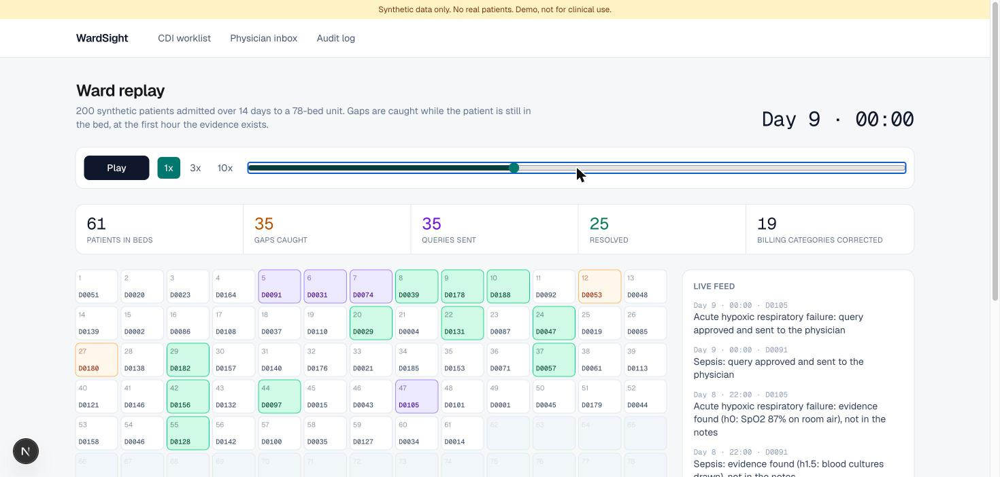
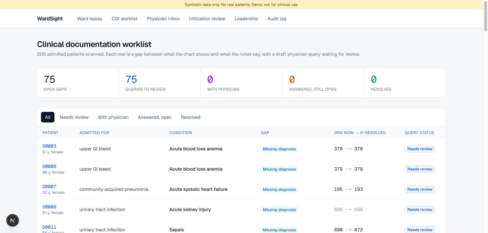
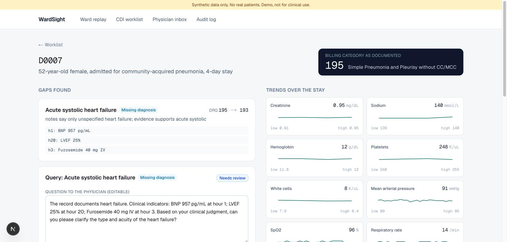
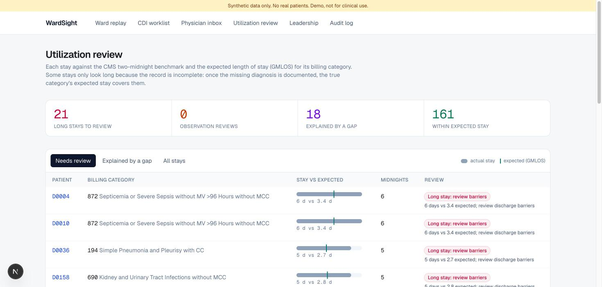
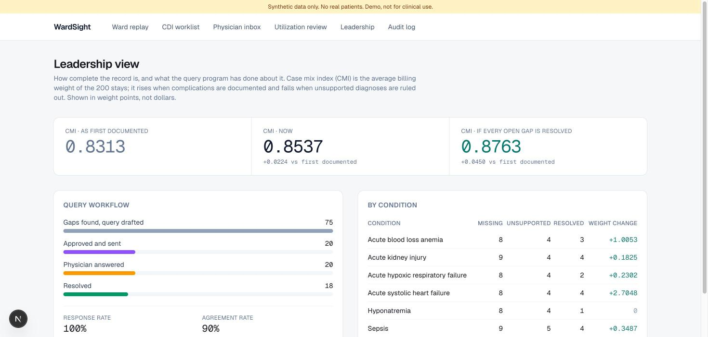

# WardSight

An AI command center for hospital clinical documentation integrity (CDI) that works while
patients are still admitted. It finds conditions the evidence supports but the notes never
name, flags diagnoses the evidence does not support, drafts compliant physician queries, and
puts a human approval step in front of anything that leaves the system.

**Everything runs on a synthetic hospital. No real patient data. Demo, not for clinical use.**

**Live demo (ward replay): https://wardsight.vercel.app**



| CDI worklist | Chart with a compliant draft query |
| --- | --- |
|  |  |
| **Utilization review** | **Leadership view** |
|  |  |

## Status

| Milestone | Status (2026-11-09) |
| --- | --- |
| 1. Data factory + answer key | Done (Synthea patients); LLM-written notes pending an API key |
| 2. Detection rules + DRG impact | Done; scored on the dev set with template notes |
| 3. Physician queries + rules check | Done; template drafter live, OpenAI drafter built and tested offline |
| 4. Web app + physician agent | Done; rule-based physician agent (LLM version pending a key) |
| 5. Ward replay + public demo build + video script | Done; hosting and recording pending ([deploy](docs/DEPLOY.md), [script](docs/DEMO_SCRIPT.md)) |
| 6. Utilization review + leadership view | Done |
| 7. FHIR import, SMART on FHIR launch, Snowflake | FHIR import done; Epic sandbox launch and Snowflake need accounts |

## Reading real FHIR data (milestone 7, part 1)

`wardsight-fhir` turns FHIR R4 (the format Epic exposes) back into a chart and runs the evidence rules.
Round trip: all 200 dev charts exported to FHIR and imported back give identical results for all six
rules. It also reads a live open FHIR server, mapping labs and vitals by LOINC code:

```
uv run wardsight-fhir --bundle data/fhir/dev/D0011.json
uv run wardsight-fhir --server https://r4.smarthealthit.org --patient <id>   # public SMART sandbox
```

## Utilization review and leadership (milestone 6)

- **Utilization review:** every stay against the CMS two-midnight benchmark and the expected length of
  stay (GMLOS) for its billing category. Stays that only look long because a diagnosis is missing are
  marked "explained by a documentation gap": once documented, the true category's expected stay covers
  them. On the dev ward: 21 long stays to review, 28 explained by a gap. (Every synthetic stay is at least
  two days, so the two-midnight check never fires on this data.)
- **Leadership:** case mix index (average billing weight) as first documented, now, and if every open gap
  is resolved; the query funnel with response and agreement rates; results by condition. Weight points,
  not dollars.
- Weights and GMLOS: CMS IPPS FY2027 Table 5 (MS-DRG v44) for the 16 DRGs in the families this ward uses, in
  `engine/drg_table.py` with their source. Verify against the CMS file before any real use.

## Ward replay (milestone 5)

The dev ward over 14 days of admissions on a 56-bed unit. Every 6 hours the engine re-reads each chart
as it stood at that moment, so a gap is raised at the first hour its evidence exists, while the patient
is still admitted. Queries are then approved, answered by the simulated physician, and the billing
category updates. Over the replay: 75 gaps caught, 57 resolved, 41 billing categories corrected (some
up, some down: unsupported diagnoses ruled out lower the bill).

```
uv run wardsight-replay                 # writes web/public/replay.json
```

## The web app (milestone 4)

A reviewer works the CDI worklist, opens a chart (evidence, trends, notes), edits a draft query while
the rules check updates live, and approves it. The physician answers in their inbox (or a simulated
physician replies). The answer becomes a note addendum, the chart is rescanned, and the billing
category updates. Every step lands in an append-only audit log.

```
uv run wardsight-api                          # http://127.0.0.1:8000
cd web && npm install && npm run dev          # http://localhost:3000
```

## The detection engine (milestone 2)

Plain code, no AI, reading only what a hospital system would hold.

1. **Evidence rules** check each chart against published criteria and keep the exact values
   behind every decision (e.g. "MAP 61 mmHg at hour 0; platelets 116").
2. **Documentation reader** finds diagnoses in the note text, with synonyms and negation
   ("acute kidney injury ruled out" does not count).
3. **Gap finder** raises `missing_dx` (evidence met, never documented) and `unsupported_dx`
   (documented, evidence absent), each with the billing category (MS-DRG v44) now and if resolved.

Dev-set score with template notes: 75 of 75 planted gaps caught, 0 false alarms. Template notes use
clean wording, so this is the easy case; LLM-written notes and the held-out set are the real test.

## Physician queries (milestone 3)

Every flag becomes a draft query to the physician, waiting for a human reviewer.

- **Code decides the substance:** the clinical indicators cited come from the chart, and the answer
  options come from fixed lists with clinically reasonable alternatives plus "Other" and "Unable to
  determine". The AI (or a template) writes only the question sentence.
- **A rules check gates every draft**, following the ACDIS/AHIMA compliant query practice brief
  (2022 update): no leading wording, the diagnosis is never named in a new-diagnosis question, no
  financial talk (DRG, reimbursement, CC/MCC), at least two clinical indicators, no yes/no for a new
  diagnosis, and no number that is not in the chart (so the AI cannot invent values).
- A rejected draft is retried with the problems listed; one that still fails is left for a human.

Dev set: 75 flags, 75 queries, all pass the rules check.

Not every gap changes payment: cellulitis and UTI groups split only on major complications, so a
complication like acute kidney injury raises severity there without moving the DRG.

## The data factory (milestone 1)

1. **Patients:** [Synthea](https://github.com/synthetichealth/synthea) supplies age, sex and
   chronic history (or a built-in generator for tests).
2. **Scenario engine:** writes each hospital stay hour by hour (labs, vitals, medications,
   orders, imaging) for six conditions: acute kidney injury, sepsis, hyponatremia, acute blood
   loss anemia, acute hypoxic respiratory failure, acute systolic heart failure. Values sit on
   a known side of published criteria (KDIGO, Sepsis-3, and others, cited in `criteria.py`).
3. **Gap planter:** decides what the notes will say and records the answer key.

| Group | Dev | Held-out | What a correct detector does |
| --- | --- | --- | --- |
| Missing diagnosis | 50 | 25 | flags it |
| Unsupported diagnosis | 25 | 12 | flags it |
| Correctly documented | 40 | 20 | stays quiet |
| Near-miss (just below criteria) | 30 | 15 | stays quiet |
| Confounder (CKD baseline creatinine) | 15 | 8 | stays quiet |
| Routine admission | 40 | 20 | stays quiet |

The held-out set is run once, at the end, for the published numbers. Detection rules are written
separately from the generator so the test does not grade its own homework.

## Run it

```
uv sync
uv run pytest -q
uv run wardsight-factory
uv run wardsight-notes --template      # or the LLM writer, with a key in .env
uv run wardsight-scan --split dev
uv run wardsight-bench --split dev
uv run wardsight-queries --split dev   # add --llm to use the OpenAI drafter
```
